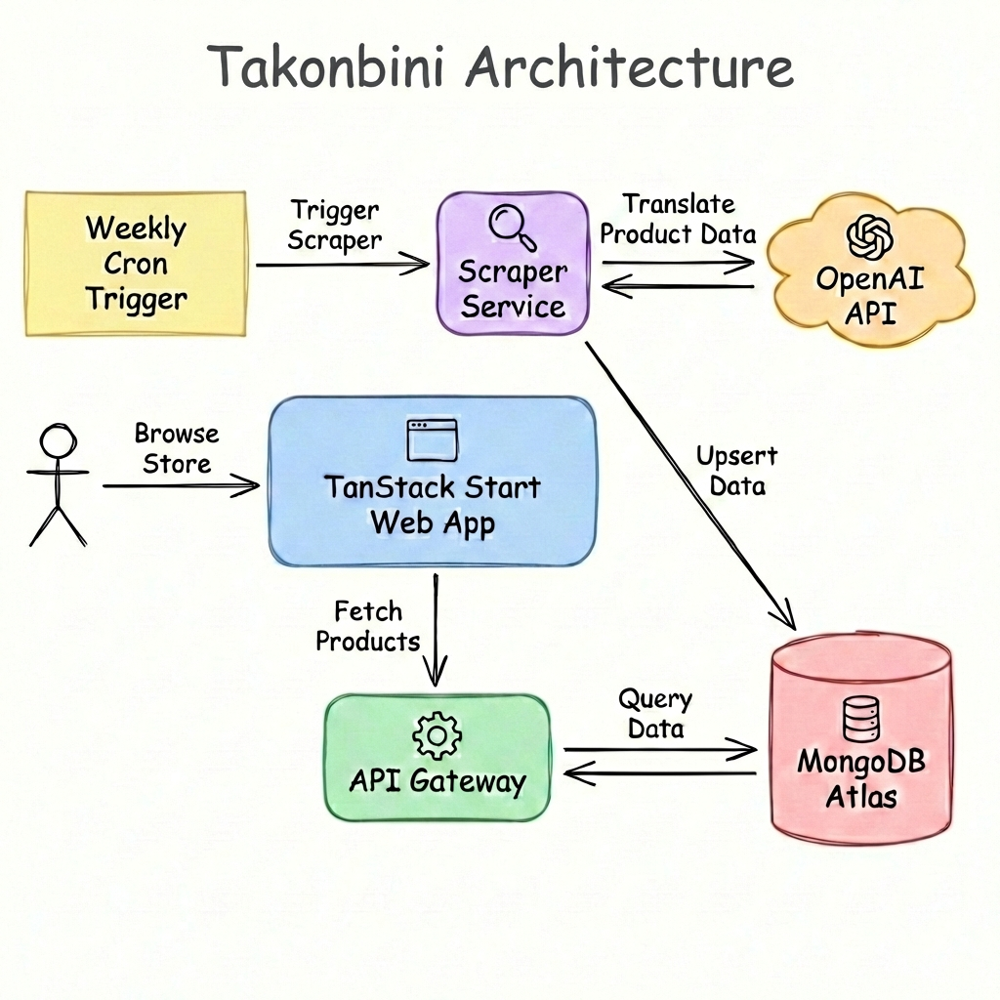

# Takonbini Web

Takonbini is a TanStack Start app for browsing Japanese convenience store products, with filters, product detail pages, and an image proxy for reliable loading.

## Features

- Product listing with filters, pagination, and SSR hydration
- Product detail pages
- Image proxy with browser + edge caching
- i18n (EN/JA/ZH) and theme switching

## Architecture

See [architecture.md](architecture.md) for data flow and other architecture details.



## Requirements

- Node.js
- pnpm

## Environment

Create a `.env.local` file:

```
PRODUCTS_API_URL="http://localhost:3001"
PRODUCTS_API_KEY="your-api-key"
```

## Development

```
pnpm install
pnpm dev
```

For local product data, keep `takonbini-api` beside this repository with its
API dependencies installed. Configure `services/api/.env.local` in that
repository with `AWS_PROFILE=default`, `AWS_REGION=ap-northeast-1`,
`MONGODB_PARAMETER_NAME=/takonbini/dev/mongodb-uri`, and the existing
`API_SECRET_KEY` matching the web app's `PRODUCTS_API_KEY`. The AWS profile
needs permission to read and decrypt that SSM parameter.

In a second terminal, run:

```bash
aws login --profile default
pnpm dev:api
```

The local launcher reads the current MongoDB credentials from SSM at startup.
It discovers Atlas servers through DNS SRV and uses a standard TLS connection
with Atlas's `admin` authentication database. This avoids the DNS TXT lookup
that times out on the current local network. Credentials stay in process
memory; the launcher does not change the SSM parameter or deployed API.
Set `TAKONBINI_API_DIR` if the API's `services/api` directory is elsewhere.

## Production

```
pnpm build
```

## Linting

```
pnpm lint
```
