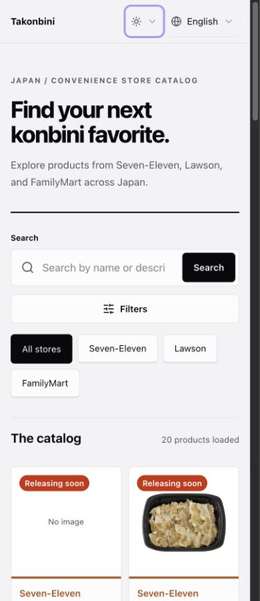
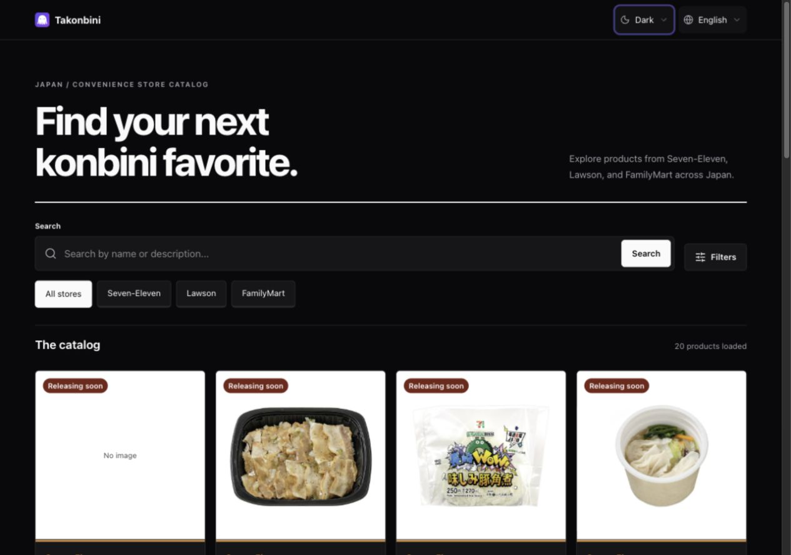
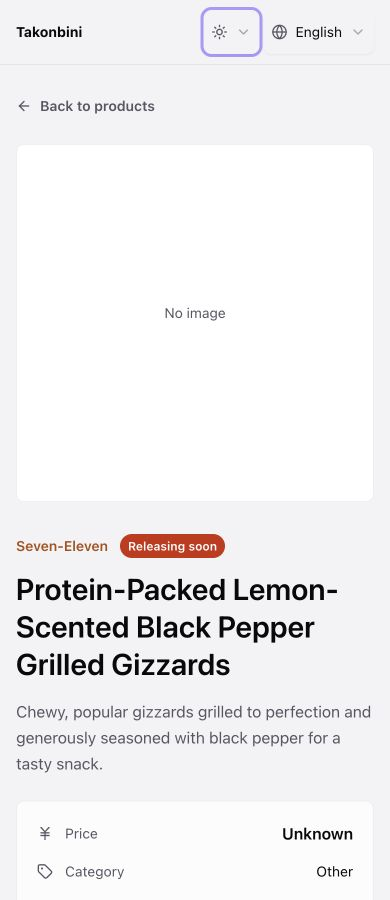
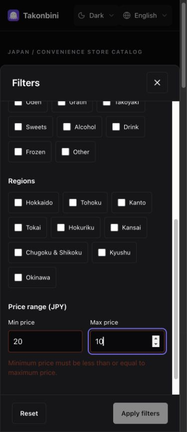

# StyleX compatibility migration evidence

Implementation for #29 and PR #73. [Navigation QA follow-up](stylex-navigation-follow-up.md)
records the user-reported issues and targeted fixes. This supersedes the integration checkpoint;
Tailwind is fully removed. No production promotion or merge is authorized here.

## Baseline and method

The immutable baseline is main `055e4f2`, after the products-module and design
plan merges. Baseline and candidate were independently built with Nitro's
node-server preset, served on local ports 3101/3102, and given the same frozen
20-product public catalog through a local HTTP fixture. Fixture variants include
missing image, zero price, future release, new-product status, empty results and
503 errors. It is controlled parity data, not a claim about live availability.

Comparisons use one browser tab sequentially at identical viewport/locale/theme
settings, inspecting rendered geometry and computed styles. Catalog, populated
detail and dialog each cover 390/768/1280px × en/ja/zh × light/dark. Dialog captures
include selected fields and invalid price bounds. Additional boundaries cover
599/600/601, 639/640, 799/800/801, 1099/1100/1101 for catalog; 1023/1024/1025 for
detail; and 599/600/601 for dialog. Compared properties match exactly.

An early detail harness accidentally rendered the missing-product screen because
its SSR loopback host lacked the port. Those results were discarded. The retained
detail matrix asserts a visible definition list and was rerun against actual
populated detail. Header descendants were also checked, catching and correcting
responsive defaults and the language icon size. Empty and error messages/actions
match baseline geometry and styles. Query retries were allowed to reach the
actual error alert before measurement.

Machine records and representative captures: [catalog](stylex-migration/full-parity.json),
[detail](stylex-migration/detail-parity.json), [dialog](stylex-migration/dialog-parity.json),
[empty/error](stylex-migration/state-parity.json).

## Runtime and source checks

- 65 tests across ten files pass; lint, TypeScript and Vercel build pass.
  Node-server builds also pass. Tests cover catalog/detail behavior, SSR, Select
  portals/keyboard/Escape/focus return, native/dynamic style composition, all
  generated dark-theme classes, early theme script and reduced-motion scrolling.
- The integration checkpoint proved actual application CSS HMR on an open Select,
  CSS extraction/order, popup overflow/positioning, focus states, system theme,
  search navigation and native-dialog Escape/focus return.
- The final source/lockfile audit finds no Tailwind package/compiler/merge helper,
  utility class strings or directives in production source. The explicit browser
  reset retains its MIT attribution. Tokens preserve the original OKLCH values;
  disabling Lightning CSS color rewriting avoids an unintended palette change.
- Reduced-motion CSS removes Select/overlay transition durations and scroll uses
  immediate behavior. Real Safari and VoiceOver, and OS-level reduced-motion
  visual checks, have not been performed in this automated browser session.
- Design docs were reconciled with the implementation. A fresh-reader API probe
  passes after fixing one stale example; it does not substitute for browser QA.

## Size and Lighthouse

Summed emitted client assets, identical Python gzip settings; these totals are
not initial-route transfer sizes. Baseline node-server and candidate Vercel client
assets use the same production client build configuration.

| Assets | Baseline raw / gzip bytes | Candidate raw / gzip bytes |
| --- | ---: | ---: |
| CSS | 44,683 / 9,189 | 32,957 / 8,517 |
| JavaScript | 560,790 / 185,495 | 544,984 / 181,228 |

One sequential local Lighthouse run gives performance 71 → 74, accessibility
100 → 100, Best Practices 96 → 96 and SEO 100 → 100. Both have zero measured CLS
and total blocking time; LCP is 4.88s → 4.48s. Both log image/resource 404s. This
single fixture-backed run shows no observed regression, not a general speedup.
Summaries: [baseline](stylex-migration/lighthouse-baseline.json),
[candidate](stylex-migration/lighthouse-candidate.json).

A [hosted preview audit](stylex-migration/lighthouse-hosted.json) on code head
`72aa444` scores performance **91**, accessibility **100**, Best Practices **96**.
LCP is 2.59s, TBT 8ms and CLS zero. This clears the performance target. Preview
SEO is 61 because Vercel sends `x-robots-tag: noindex` and canonical points to
production; indexing must remain disabled on previews. Local SEO is 100. Confirm
production SEO after release; do not remove preview protection to raise a score.

## Remaining merge and release gates

The preceding products-module release (#71, merged 16 October 2026 00:24 UTC)
still requires its post-release verification and 24-hour observation acceptance.
Even using merge time as the earliest possible start, the window cannot end
before 17 October 2026 00:24 UTC (08:24 MYT); actual deployment/checkpoint timing
may be later. Elapsed time alone does not establish acceptance.

Retain main `055e4f2`, its lockfile and preceding Vercel deployment as rollback
inputs. The baseline was rebuilt locally; no live rollback/alias drill was
performed. The earlier maintainer acceptance of source/build/deployment recovery
with a deferred live drill is recorded in the Phase 7A reconciliation. The StyleX
release still needs production verification and its own observation window after
an explicitly approved merge. Issue #29 remains open until release gates pass.

Code head `72aa444` passes GitHub Web CI, both Socket checks and Vercel. The
[hosted preview](https://takonbini-web-git-codex-927713-sean-cheong-zhen-xiongs-projects.vercel.app)
loads populated catalog/detail, dark theme, portalled selectors, direct detail
reload and Japanese locale with no captured console warning/error.
[Hosted detail capture](stylex-migration/hosted-detail-ja-dark.jpg). Merge remains
subject to explicit user approval for PR #73; no automatic merge is configured.
