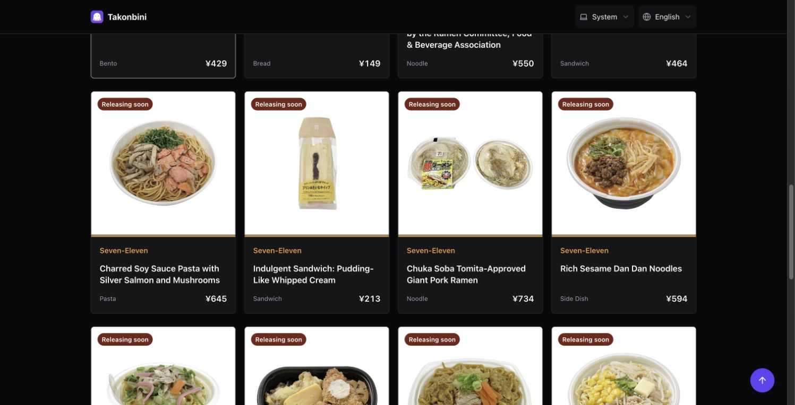

# Navigation QA follow-up — 17 October 2026

The user reported Chrome header movement, Safari loading text, and lost catalog
scroll when returning through the detail-page link. These are targeted navigation
corrections requested during migration QA, separate from the styling conversion.

## Return scroll: reproduced and fixed

The baseline `055e4f2` and pre-fix candidate both return to scrollY 0 after leaving
a catalog position of 720 through the detail link. Browser Back uses the original
history entry, while the return Link creates an entry without its saved position.
The app now uses normalized catalog filters as catalog scroll keys; detail pages
retain their history-entry keys. Default limit/query serialization does not split
one catalog into multiple scroll identities. Different filters remain separate.

The browser check exposed another cause: global router loading adds a separate
catalog refresh output even when entering/leaving detail. Its 20px line and 28px
gap disappear after restoration, moving scroll by 48px. Refresh status now follows
catalog-to-catalog navigation or the catalog query's own fetch state, never a
cross-route detail navigation. A temporary image-position experiment was removed;
no product-image geometry change is included.

The real-router integration test first failed with expected 720 / actual 0, then
passed after the key fix. It covers the actual ProductCard and ProductDetailScreen
links, normalized query values, filter separation and browser Back. Two panel
regressions first failed because the refresh output appeared during cross-route
navigation; both pass with the scoped selector. In-catalog pending feedback stays.

Final production-build checks used direct pointer clicks on visible images. Chrome
restored **1445 → 1445** and WebKit **1454 → 1454**. Earlier locator-driven attempts
scrolled off-screen/focused links automatically and were discarded as exact-position
comparisons. Records: [before](stylex-migration/navigation-before.json),
[after](stylex-migration/navigation-after.json).

## Safari loading text

Both the navigation overlay and separate image-loading label exist in the main
baseline. Safari deliberately skips shared-image view transitions and shows a
navigation indicator while detail loading is pending. Detail images may show the
image-loading label until their own load/decode completes. This is existing
behavior, not by itself evidence of a failed request or StyleX regression.
A test verifies that clicking an already-loaded card in Safari does not reset its
image-loading state or remove its image while the navigation indicator appears.
No loading feedback was removed.

## Chrome header: not yet reproduced

Chrome production-build live header/control rectangles remain unchanged through
navigation. Temporary local five-second transition captures showed identical menu
pixels, apart from a one-pixel bottom-border difference in a scrolled capture;
that does not reproduce the reported menu movement. The diagnostic duration was
removed, and no speculative header CSS change is included. The old header and
view-transition rules are materially the same as the migration source, but that
alone does not prove the report predates StyleX. Direction/scroll context and a
fresh-preview retest are still needed before closing this report.
